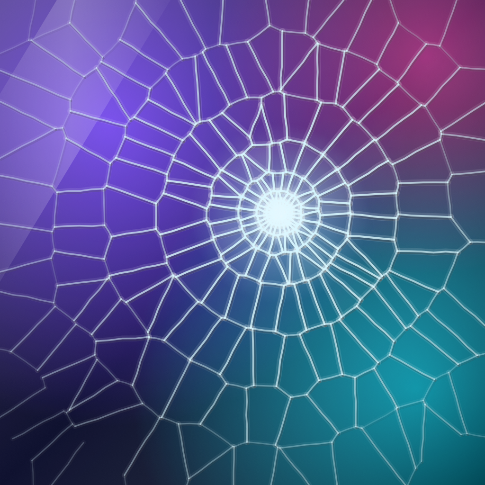

# Shattter

The ultimate glass-breaking gag app for iPhone Duo. Native UIKit + SwiftUI, no dependencies.

- **Unfolded:** bend the hinge and stress webs crack out along the crease, with crackling sounds and haptics, until the pane gives way.
- **Folded or unfolded:** every tap leaves its own crack web. Tap the same spot again and it spreads. After the chosen number of hits (1, 2, 3, 5, 8, or never), cracks race across the whole pane and it bursts.
- **Six shatter animations:** Explode, Crumble, Black Hole (shards spiral into the impact, then pop), Blast (shockwave), Slow-Mo, and Hang & Drop. Or let it surprise you.
- **Prank screens:** the glass can sit over a convincing fake Lock Screen (live time, "Did you drop your phone again??" notification), Home Screen, Messages thread, switched-off screen, or photo. When a fake screen breaks, it shows a dead, bleeding LCD, then optionally "Gotcha! 😜".
- **Repairs:** Fade In with a fresh pane, or Rewind, where the shards fly back and reassemble.
- **Hidden options:** hold anywhere with two fingers. Shake the phone to smash it outright. The title only shows briefly when the plain Glass screen opens; fake screens never show it.

## How it works

| File | Responsibility |
| --- | --- |
| `Shattter/Glass/FractureGeometry.swift` | Seeded Voronoi fracture patterns: spider-web impacts, stress webs along the crease, and combined multi-impact patterns. Neighbouring shards share identical jagged edges. |
| `Shattter/Glass/GlassView.swift` | Multi-hit crack webs (pre-built pool for instant cracks), hinge stress, intro, effects. |
| `Shattter/Glass/GlassView+Shatter.swift` | Shatter styles, shard physics, Fade In and Rewind repairs. |
| `Shattter/Screens/ScreenArt.swift` | Fake Lock Screen, Home Screen, Messages, Screen Off and photo. |
| `Shattter/Options/` | Settings model and the hidden SwiftUI options sheet. |
| `Shattter/Glass/GlassViewController.swift` | `UIHingeInteraction` (iOS 27.1) hinge angle/status updates and shake handling. |
| `Shattter/Glass/PaneArtwork.swift` | Renders the pane and pre-cuts shard sprites off the main thread while cracks spread. |
| `Shattter/Audio/GlassSound.swift` | Procedural glass synthesis (impact transient, crash body, inharmonic shard tinkles, floor bounces) and Core Haptics patterns. No audio files. |

## Build, test, ship

`project.yml` is the source of truth; run `xcodegen generate` after adding files.

```sh
xcodebuild -project Shattter.xcodeproj -scheme Shattter \
  -destination 'platform=iOS Simulator,name=iPhone Duo' -derivedDataPath build build
xcodebuild -project Shattter.xcodeproj -scheme Shattter \
  -destination 'platform=iOS Simulator,name=iPhone 18 Pro' -derivedDataPath build-tests test
./scripts/testflight.sh   # archive + upload to App Store Connect (build numbers auto-increment)
```

Tuning tools:

```sh
swiftc scripts/FracturePreview/main.swift Shattter/Glass/FractureGeometry.swift -o build/fracture-preview && build/fracture-preview /tmp/fracture.png 5
swiftc scripts/AppIcon/main.swift Shattter/Glass/FractureGeometry.swift -o build/appicon && build/appicon Shattter/Resources/Assets.xcassets/AppIcon.appiconset/AppIcon.png
```

Debug builds accept `-ShowOptions` to open the options sheet at launch. On the simulator, `agent-device fold open|half-open|closed --keyframes '[{"atMs":0,"angle":180},{"atMs":800,"angle":120}]'` drives the hinge.
